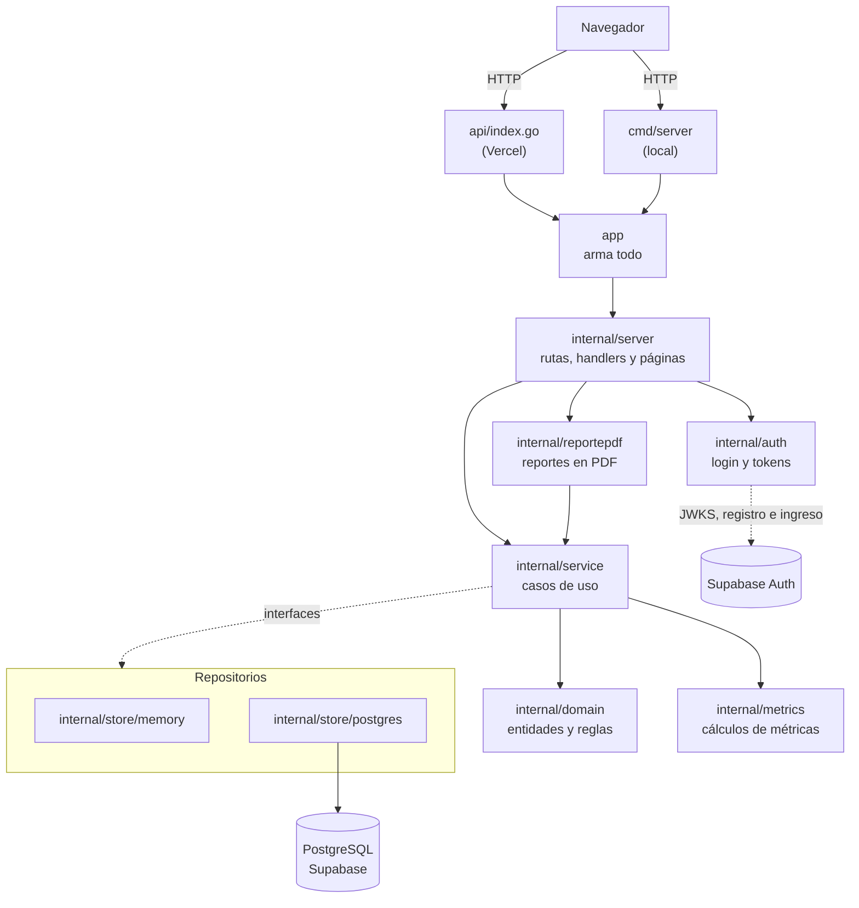

# Arquitectura

> **Borrador** (24/10/2026, Juan Pablo). Documentación técnica de la entrega (consigna, entregable 12). Describe cómo
> está armada la aplicación con TEC-05 (login) y HU-39 (PDF); lo marcado [A CONFIRMAR] se cierra antes del 30/10. El
> manual de uso está en [`manual-usuario.md`](manual-usuario.md) y el despliegue en
> [`deploy.md`](deploy.md), el modelo de datos en [`modelo-datos.md`](modelo-datos.md) y las fórmulas en
> [`metricas.md`](metricas.md).

## 1. Vista general

Es una aplicación web **renderizada en el servidor**: Go arma cada página HTML completa con `html/template` y el
navegador solo la muestra. No hay una API JSON ni un frontend aparte. El mismo código corre de dos formas:

- **En producción**, en Vercel, como una función serverless (`api/index.go`), con los datos en PostgreSQL de Supabase
  y el login de Supabase Auth.
- **En local**, con `go run ./cmd/server`. Si no hay `DATABASE_URL`, guarda los datos en memoria; si no están las
  variables de Supabase Auth, no pide login.

## 2. Paquetes

| Paquete | Qué tiene | Depende de |
|---|---|---|
| `internal/domain/...` | Las entidades (`project`, `member`, `backlog`, `sprint`, `effort`, `defect`, `account`) con sus reglas de negocio y validaciones, y las fechas (`SoloFecha`, `HoyEnArgentina`) | `internal/metrics` |
| `internal/metrics` | Las métricas de la consigna (M1 a M9, ver `metricas.md`): funciones puras, sin base ni HTTP | nada |
| `internal/service` | Los casos de uso (crear un proyecto, cerrar un sprint, el panel, los reportes…). Valida con el dominio, calcula con `metrics` y guarda o lee con los repositorios. **Define las interfaces de los repositorios** que necesita | `domain`, `metrics` |
| `internal/store/memory` | Los repositorios en memoria (local, tests y previews sin base) | `domain` |
| `internal/store/postgres` | Los repositorios sobre PostgreSQL con `pgx` | `domain`, `migrations` |
| `internal/auth` | La configuración de Supabase Auth, la verificación local de los tokens con el JWKS y el cliente de registro e ingreso (TEC-05) | `domain/account` |
| `internal/reportepdf` | Pasa a PDF el reporte de un sprint y el del proyecto con los mismos textos que la página (HU-39), con `codeberg.org/go-pdf/fpdf` | `service` |
| `internal/server` | El router (`chi`), el middleware de sesión, un handler por pantalla y el renderizado de las plantillas | `service`, `auth`, `reportepdf`, `domain`, `web` |
| `web` | Las plantillas HTML, embebidas en el binario (`//go:embed`) | nada |
| `app` | Arma la aplicación: elige memoria o PostgreSQL, crea los casos de uso y el router | todo lo anterior |
| `api` | La función de Vercel: le pasa cada pedido al router de `app` | `app` |
| `cmd/server` | El servidor local | `app` |
| `cmd/migrar` | Aplica las migraciones con goose (`up`, `status`) | `migrations` |
| `cmd/cobertura`, `internal/cobertura` | El umbral de cobertura del CI (TEC-06) | nada |
| `migrations` | Las migraciones SQL versionadas, embebidas | nada |
| `features` | Los escenarios BDD (godog, en español) y sus pasos | `app`, `service`, … |

**Regla de dependencias:** las flechas van siempre hacia el dominio. `domain` y `metrics` no saben que existe una base,
un servidor web o Vercel, por eso se prueban con tests unitarios simples y son los paquetes del umbral de cobertura.
`service` no importa `store`: pide interfaces (por ejemplo `RepositorioSprints`) y `app` le pasa la implementación.
Así el mismo caso de uso funciona en memoria y en PostgreSQL, y los tests usan dobles o el repositorio en memoria.

**Por qué existe `app`:** Vercel compila `api/index.go` fuera del módulo, y Go no deja importar paquetes `internal/`
desde afuera. `app` está dentro del módulo y expone el router armado.

## 3. Recorrido de un pedido

Ejemplo: cerrar el Sprint 1 (HU-14), `POST /proyectos/1/sprints/1/cerrar`.

1. **Vercel** recibe el pedido y, por `vercel.json`, lo manda a `api/index.go`, que se lo pasa al router.
2. **`internal/server`**: el router de `chi` elige el handler de cierres, que lee el id del proyecto y el número del
   sprint de la URL.
3. **`internal/service`**: `Cierres.Cerrar` busca el proyecto, el sprint y sus historias con los repositorios.
4. **`internal/domain/sprint`** decide si se puede cerrar y arma la foto del cierre; los SP planificados y completados
   salen de **`internal/metrics`** (HU-30).
5. **`internal/store/postgres`** guarda el sprint cerrado, la foto y las historias que vuelven al backlog **en una
   sola transacción**.
6. **`internal/server`** responde con una redirección (303) a la página del sprint (patrón Post/Redirect/Get: recargar
   la página no repite el cierre).

Las consultas, como el reporte de sprint (HU-37), hacen lo mismo sin el paso 5: el caso de uso lee, calcula con
`metrics` y el handler renderiza la plantilla.

## 4. Autenticación (TEC-05)

El login es de **Supabase Auth** con email y contraseña. Detalle en
[`specs/TEC-05-autenticacion.md`](../specs/TEC-05-autenticacion.md) y en el spike
[`spike-supabase-auth.md`](spike-supabase-auth.md).

- **Se activa por configuración:** con `SUPABASE_URL` y `SUPABASE_ANON_KEY` (solo en Production de Vercel) la app pide
  login; sin ellas no pide nada, como en local, en los tests y en los previews.
- **Registro e ingreso:** las pantallas `/registro` y `/login` mandan las credenciales a Supabase. Al ingresar, el token
  de acceso queda en la cookie `sesion` (`HttpOnly`, `SameSite=Lax`, `Secure` con HTTPS).
- **Cada pedido** pasa por un middleware de `internal/server` que valida el token **sin llamar a Supabase**: la firma
  con las claves públicas del JWKS del proyecto (ES256 o RS256; se rechazan HS256 y `none`), el emisor, la audiencia y
  el vencimiento. Sin sesión válida responde 401 con la página de login. `/health`, `/login`, `/registro` y `/salir`
  quedan abiertas.
- **Vínculo con los integrantes:** al ingresar, la cuenta se vincula por email con los integrantes de todos los
  proyectos (`integrantes.auth_user_id`). Así el sistema sabe quién es quién, por ejemplo para votar en Planning Poker.
- **Quién puede entrar:** el registro de cuentas nuevas está cerrado en Supabase; solo tienen cuenta los integrantes
  del equipo (y los profesores, que se agregan desde el panel de Supabase). Cualquier cuenta ve todos los proyectos:
  qué puede hacer cada rol quedó fuera del alcance.

## 5. Manejo de errores

| Situación | Dónde se detecta | Respuesta |
|---|---|---|
| Dato inválido en un formulario (campo vacío, fecha fuera de rango, SP que no es de Fibonacci) | El dominio devuelve `domain.ErroresValidacion` (un error por campo) | **422**: la misma página con el formulario, los valores cargados y el mensaje al lado de cada campo |
| El proyecto, sprint o historia no existe | El repositorio devuelve `ErrNoEncontrado` del paquete de la entidad | **404** con un mensaje ("No encontramos ese sprint.") |
| Una regla de negocio no se cumple (cerrar un sprint que no está activo, editar una historia de un sprint cerrado) | El dominio o el caso de uso devuelven un error propio | **409** o **422** con el motivo en la página |
| Falla la base o algo inesperado | Cualquier capa (los errores se envuelven con `fmt.Errorf("…: %w", err)`) | **500** con un mensaje genérico; el detalle queda en el log (`log.Printf`), nunca en la página |

## 6. Datos: memoria o PostgreSQL

- **Sin `DATABASE_URL`**: repositorios en memoria. Se pierde todo al reiniciar. Es lo que usan el servidor local, los
  tests y los previews de Vercel.
- **Con `DATABASE_URL`**: repositorios de PostgreSQL (Supabase) por el *transaction pooler*. La conexión se abre en el
  primer pedido, no al arrancar.
- **Migraciones** con goose desde `cmd/migrar`, con `MIGRATIONS_DATABASE_URL` (*session pooler*). Una migración aplicada
  nunca se edita: cada cambio es una migración nueva. Hoy hay tres (`0001` modelo inicial, `0002` RLS de la tabla de
  versiones, `0003` historial de estimaciones).
- **Seguridad:** todas las tablas tienen RLS activado y sin políticas, así la API pública de Supabase no puede leer ni
  escribir nada. La app entra con el usuario `postgres`, que no está sujeto a RLS.
- La base no hace borrados en cascada: lo que se borra junto (una historia con sus criterios y tareas, HU-06) lo borra
  la aplicación en una transacción.

## 7. Interfaz

- **Plantillas:** un layout (`web/templates/base.html`) y una plantilla por página (`web/templates/paginas/`), con
  bloques compartidos. Están embebidas en el binario, así Vercel no depende de archivos sueltos.
- **Bootstrap 5** desde CDN para el diseño y la adaptación al celular; las tablas van en `table-responsive`.
- **Sin JavaScript propio:** los formularios son HTML comunes (POST + redirección). HTMX está cargado en el layout pero
  todavía no se usa: queda para el retoque visual de la interfaz (acciones sin recargar la página entera). La librería
  de gráficos entra con HU-36.
- **Impresión y PDF:** los reportes ocultan la navegación y los botones con `d-print-none` (HU-37) y se descargan en
  PDF (HU-39). El PDF se arma en el servidor con los mismos datos y textos que la página, en memoria y sin servicios
  externos: un proyecto de 12 sprints se genera en menos de un segundo, lejos del límite de 10 s de Vercel.
- **Accesibilidad:** enlace para saltar al contenido, `label` en cada campo y `aria-label` en los resúmenes.

## 8. Fechas y zona horaria

Las fechas del dominio son días sin hora (`domain.SoloFecha`, a medianoche UTC), así comparar fechas no depende de la
zona. "Hoy" se calcula en hora de Argentina (`domain.HoyEnArgentina`, UTC−3 fija): Vercel corre en UTC y, entre las
21:00 y las 24:00, allá ya es mañana. Las horas que se muestran (el historial de estimaciones, HU-16b) se pasan a hora
de Argentina con `domain.FechaHoraEnArgentina`. El nombre de los PDF lleva la fecha de hoy en la Argentina (HU-39).

## 9. Pruebas y calidad

| Nivel | Qué prueba | Dónde |
|---|---|---|
| Unitarias (TDD) | Reglas del dominio y métricas | `internal/domain/...`, `internal/metrics` |
| Casos de uso | Cada caso de uso con repositorios en memoria o dobles que fallan | `internal/service` |
| Pantallas | Handlers y plantillas con `httptest`: códigos, textos y formularios | `internal/server` |
| Repositorios PostgreSQL | Contra un PostgreSQL descartable (`TEST_DATABASE_URL`); cada test crea y borra su esquema | `internal/store/postgres`, `app`, `cmd/migrar` |
| BDD | Los escenarios de cada `.feature` contra la aplicación armada en memoria | `features` |
| Trazabilidad | Que cada requerimiento de la consigna tenga su historia, sus escenarios y sus tests, y que lo que nombra exista | `features/trazabilidad_test.go`, `docs/trazabilidad-requisitos.md` |

El **CI** (`.github/workflows/ci.yml`) corre en cada PR: gofmt, `go vet`, golangci-lint, tests con race detector y
cobertura (con un PostgreSQL propio), los escenarios BDD y el umbral de cobertura (TEC-06: 80 % combinado de
`internal/domain` e `internal/metrics`). Si algo falla, el PR no se puede mergear. La evidencia de TDD está en el
historial: cada `test(HU-xx): RED` va en un commit antes de su `feat(HU-xx): GREEN`.

## 10. Decisiones de arquitectura

| # | Decisión | Por qué | Alternativa descartada |
|---|---|---|---|
| 1 | Páginas renderizadas en el servidor con `html/template` | Un solo lenguaje para todo el equipo, sin build de frontend; la consigna pide el núcleo en Go | SPA con React y una API JSON: el doble de código y de tests |
| 2 | Interfaces de repositorio definidas en `service` | El caso de uso no depende de la base: se prueba en memoria y se cambia de base sin tocarlo | Llamar a `pgx` desde los casos de uso |
| 3 | Repositorios en memoria además de PostgreSQL | Tests rápidos sin base, previews de Vercel sin Supabase y desarrollo local sin instalar nada | Exigir PostgreSQL para todo |
| 4 | Vercel con una sola función (`api/index.go`) y el paquete `app` | Deploy automático por PR con preview, gratis; `app` evita la restricción de `internal/` | Un servidor propio (Render, Fly): más configuración y sin previews por PR |
| 5 | Supabase PostgreSQL con RLS sin políticas | Base administrada y gratuita; RLS cierra la API pública que Supabase expone por defecto | Abrir la API pública con políticas: no hace falta, la app entra directo |
| 6 | Migraciones SQL con goose, embebidas | SQL a la vista para revisar en el PR, versionado y repetible | Crear las tablas a mano en el panel de Supabase |
| 7 | Métricas como funciones puras en `internal/metrics` | Se prueban con tablas de casos, se reutilizan en el panel y los reportes (HU-35, HU-37) y no pueden dar distinto en dos pantallas | Calcular en cada pantalla o en SQL |
| 8 | Foto del cierre del sprint (`sprint_historias`) | El reporte de un sprint cerrado no cambia aunque después se re-estime o se mueva una historia | Recalcular siempre con los datos de hoy |
| 9 | Fechas sin hora y "hoy" en hora de Argentina | Evita errores de un día por la zona horaria del servidor | Usar `time.Now()` directo |
| 10 | Login con Supabase Auth y el token validado localmente con el JWKS | Contraseñas fuera de nuestra base, sin llamar a Supabase en cada pedido y activable por configuración (los previews siguen sin login) | Usuarios y contraseñas propios en PostgreSQL: más código sensible que mantener |
| 11 | PDF generado en el servidor con `codeberg.org/go-pdf/fpdf` v0.11.1 | Go puro y con la fuente incluida (nada que desplegar aparte), rápido para el límite de Vercel; el contenido sale de los mismos textos que la página | Imprimir a PDF desde el navegador: no descarga un archivo con nombre (CA-39.1) |
