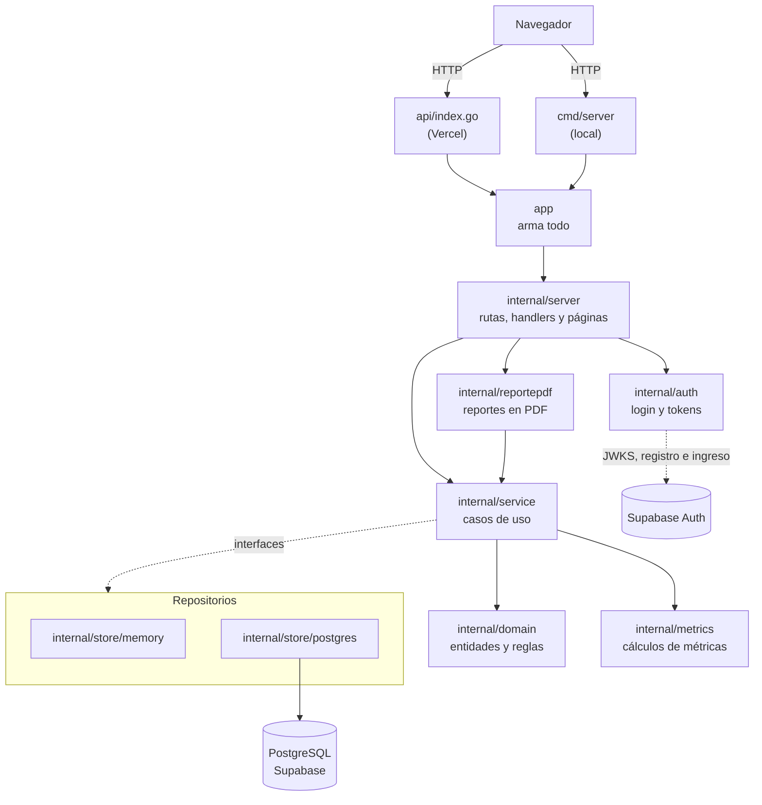

# Arquitectura

> Documentación técnica de la entrega (consigna, entregable 12), al 29/10/2026, el día del congelamiento del código.
> Describe cómo está armada la aplicación entregada.
>
> Otros documentos:
> - el manual de uso: [`manual-usuario.md`](manual-usuario.md);
> - el despliegue: [`deploy.md`](deploy.md);
> - el modelo de datos: [`modelo-datos.md`](modelo-datos.md);
> - las fórmulas de las métricas: [`metricas.md`](metricas.md).

## 1. Vista general

Es una aplicación web **renderizada en el servidor**: Go arma cada página HTML completa con `html/template` y el
navegador solo la muestra. No hay un frontend aparte: el único JavaScript es el de dos librerías por CDN. HTMX
actualiza partes de la página de Planning Poker, y Chart.js dibuja los gráficos (HU-36) con el único endpoint JSON de
la app. El mismo código corre de dos formas:

- **En producción**, en Vercel, como una función serverless (`api/index.go`), con los datos en PostgreSQL de Supabase
  y el login de Supabase Auth.
- **En local**, con `go run ./cmd/server`. Si no hay `DATABASE_URL`, guarda los datos en memoria; si no están las
  variables de Supabase Auth, no pide login.

## 2. Paquetes

| Paquete | Qué tiene | Depende de |
|---|---|---|
| `internal/domain/...` | Las entidades (`project`, `member`, `backlog`, `sprint`, `effort`, `defect`, `poker`, `account`) con sus reglas de negocio y validaciones, y las fechas (`SoloFecha`, `HoyEnArgentina`) | `internal/metrics` |
| `internal/metrics` | Las métricas de la consigna (M1 a M9, ver `metricas.md`): funciones puras, sin base ni HTTP | nada |
| `internal/service` | Los casos de uso (crear un proyecto, cerrar un sprint, el panel, los reportes…). Valida con el dominio, calcula con `metrics` y guarda o lee con los repositorios. **Define las interfaces de los repositorios** que necesita | `domain`, `metrics` |
| `internal/store/memory` | Los repositorios en memoria (local, tests y previews sin base) | `domain` |
| `internal/store/postgres` | Los repositorios sobre PostgreSQL con `pgx` | `domain`, `migrations` |
| `internal/auth` | La configuración de Supabase Auth, la verificación local de los tokens con el JWKS y el cliente de registro e ingreso (TEC-05) | `domain/account` |
| `internal/reportepdf` | Pasa a PDF el reporte de un sprint y el del proyecto con los mismos textos que la página (HU-39), con `codeberg.org/go-pdf/fpdf` | `service` |
| `internal/server` | El router (`chi`), el middleware de sesión, un handler por pantalla y el renderizado de las plantillas | `service`, `auth`, `reportepdf`, `domain`, `web` |
| `web` | Las plantillas HTML, embebidas en el binario (`//go:embed`): el layout, los componentes compartidos (TEC-07 y TEC-07b) y una página por pantalla | nada |
| `app` | Arma la aplicación: elige memoria o PostgreSQL, crea los casos de uso y el router | todo lo anterior |
| `api` | La función de Vercel: le pasa cada pedido al router de `app` | `app` |
| `cmd/server` | El servidor local | `app` |
| `cmd/migrar` | Aplica las migraciones con goose (`up`, `status`) | `migrations` |
| `cmd/ejemplo`, `internal/ejemplo` | Carga un proyecto de ejemplo de 3 sprints con los mismos casos de uso de las pantallas: en memoria para la demo, o en la base con `-base` (#440) | `app`, `service` |
| `cmd/cobertura`, `internal/cobertura` | El umbral de cobertura del CI (TEC-06) | nada |
| `migrations` | Las migraciones SQL versionadas, embebidas | nada |
| `features` | Los escenarios BDD (godog, en español) y sus pasos | `app`, `service`, … |

**Regla de dependencias:** las flechas van siempre hacia el dominio. `domain` y `metrics` no saben que existe una base,
un servidor web o Vercel, por eso se prueban con tests unitarios simples y son los paquetes del umbral de cobertura.
`service` no importa `store`: pide interfaces (por ejemplo `RepositorioSprints`) y `app` le pasa la implementación.
Así el mismo caso de uso funciona en memoria y en PostgreSQL, y los tests usan dobles o el repositorio en memoria.

**Por qué existe `app`:** Vercel compila `api/index.go` fuera del módulo, y Go no deja importar paquetes `internal/`
desde afuera. `app` está dentro del módulo y expone el router armado.

## 3. Recorrido de un pedido

Ejemplo: cerrar el Sprint 1 (HU-14), `POST /proyectos/1/sprints/1/cerrar`.

1. **Vercel** recibe el pedido y, por `vercel.json`, lo manda a `api/index.go`, que se lo pasa al router.
2. **`internal/server`**: el router de `chi` elige el handler de cierres, que lee el id del proyecto y el número del
   sprint de la URL.
3. **`internal/service`**: `Cierres.Cerrar` busca el proyecto, el sprint y sus historias con los repositorios.
4. **`internal/domain/sprint`** decide si se puede cerrar y arma la foto del cierre; los SP planificados y completados
   salen de **`internal/metrics`** (HU-30).
5. **`internal/store/postgres`** guarda el sprint cerrado, la foto y las historias que vuelven al backlog **en una
   sola transacción**.
6. **`internal/server`** responde con una redirección (303) a la página del sprint (patrón Post/Redirect/Get: recargar
   la página no repite el cierre).

Las consultas, como el reporte de sprint (HU-37), hacen lo mismo sin el paso 5: el caso de uso lee, calcula con
`metrics` y el handler renderiza la plantilla.

## 4. Autenticación (TEC-05)

El login es de **Supabase Auth** con email y contraseña. Detalle en
[`specs/TEC-05-autenticacion.md`](../specs/TEC-05-autenticacion.md) y en el spike
[`spike-supabase-auth.md`](spike-supabase-auth.md).

- **Se activa por configuración:** con `SUPABASE_URL` y `SUPABASE_ANON_KEY` (solo en Production de Vercel) la app pide
  login; sin ellas no pide nada, como en local, en los tests y en los previews.
- **Registro e ingreso:** las pantallas `/registro` y `/login` mandan las credenciales a Supabase. Al ingresar, el token
  de acceso queda en la cookie `sesion` (`HttpOnly`, `SameSite=Lax`, `Secure` con HTTPS).
- **Cada pedido** pasa por un middleware de `internal/server` que valida el token **sin llamar a Supabase**: la firma
  con las claves públicas del JWKS del proyecto (ES256 o RS256; se rechazan HS256 y `none`), el emisor, la audiencia y
  el vencimiento. Sin sesión válida responde 401 con la página de login. `/health`, `/login`, `/registro` y `/salir`
  quedan abiertas.
- **Vínculo con los integrantes:** al ingresar, la cuenta se vincula por email con los integrantes de todos los
  proyectos (`integrantes.auth_user_id`). Así el sistema sabe quién es quién, por ejemplo para votar en Planning Poker.
- **Quién puede entrar:** el registro de cuentas nuevas está cerrado en Supabase; solo tienen cuenta los integrantes
  del equipo (y los profesores, que se agregan desde el panel de Supabase). Cualquier cuenta ve todos los proyectos:
  qué puede hacer cada rol quedó fuera del alcance.

## 5. Planning Poker (HU-17 a HU-22)

La épica la hicieron tres personas en paralelo. Para no pisarse, se armó primero un **modelo común** (#430):
- los tipos `Sesion`, `Ronda` y `Voto` en `internal/domain/poker`;
- cada historia con su propio archivo en cada capa y su propia interfaz de repositorio: `RepositorioSesionesPoker`
  (HU-17), `RepositorioVotosPoker` (HU-18), `RepositorioRevelarPoker` (HU-19) y `RepositorioAcordarPoker` (HU-22);
- un solo tipo `Poker` por repositorio que las implementa todas.

| Paso | Historia | Cómo funciona |
|---|---|---|
| Abrir la sesión | HU-17 | Solo el Agile Enabler activo. Hay una sola sesión abierta por historia, y lo garantiza un índice único parcial de la base (`WHERE estado = 'Abierta'`), aunque se abra dos veces a la vez |
| Votar | HU-18 | Cada participante vota un valor de la escala de HU-16 y puede cambiarlo hasta que se revele. **Los valores no salen del repositorio** hasta revelar: `QuienesVotaron` devuelve solo los IDs, así ninguna pantalla ni respuesta puede mostrarlos. La lista de quién votó se actualiza cada 5 segundos con HTMX (`hx-get` a `…/poker/votos`) |
| Revelar | HU-19 | La ronda se revela sola cuando votaron todos los integrantes activos, o antes si la cierra el Agile Enabler. Solo cuentan los votos de los integrantes activos. Las otras pestañas se enteran en la siguiente consulta de HTMX, que responde `HX-Refresh` para recargar la página con la tabla de votos |
| Registrar la estimación | HU-22 | El Agile Enabler elige el valor acordado con la ronda revelada. **En una sola transacción** se cierra la sesión (solo si sigue abierta), se guardan los story points y se anota el cambio en el historial de HU-16b. La sesión queda en "Sesiones cerradas" y se puede abrir otra |

**Quién hace cada cosa:** con login, es el integrante vinculado a la cuenta (sección 4). Sin login, como en local o en
los previews, se elige en un desplegable del formulario.

No hubo que migrar: las tablas `sesiones_poker`, `rondas_poker` y `votos` están desde la `0001`. HU-20 (destacar las
diferencias) y HU-21 (nuevas rondas) quedaron afuera de la entrega.

## 6. Manejo de errores

| Situación | Dónde se detecta | Respuesta |
|---|---|---|
| Dato inválido en un formulario (campo vacío, fecha fuera de rango, SP que no es de Fibonacci) | El dominio devuelve `domain.ErroresValidacion` (un error por campo) | **422**: la misma página con el formulario, los valores cargados y el mensaje al lado de cada campo |
| El proyecto, sprint o historia no existe | El repositorio devuelve `ErrNoEncontrado` del paquete de la entidad | **404** con un mensaje ("No encontramos ese sprint.") |
| Una regla de negocio no se cumple (cerrar un sprint que no está activo, editar una historia de un sprint cerrado) | El dominio o el caso de uso devuelven un error propio | **409** o **422** con el motivo en la página |
| Falla la base o algo inesperado | Cualquier capa (los errores se envuelven con `fmt.Errorf("…: %w", err)`) | **500** con un mensaje genérico; el detalle queda en el log (`log.Printf`), nunca en la página |

## 7. Datos: memoria o PostgreSQL

- **Sin `DATABASE_URL`**: repositorios en memoria. Se pierde todo al reiniciar. Es lo que usan el servidor local, los
  tests y los previews de Vercel.
- **Con `DATABASE_URL`**: repositorios de PostgreSQL (Supabase) por el *transaction pooler*. La conexión se abre en el
  primer pedido, no al arrancar.
- **Migraciones** con goose desde `cmd/migrar`, con `MIGRATIONS_DATABASE_URL` (*session pooler*). Una migración aplicada
  nunca se edita: cada cambio es una migración nueva. Hay tres:
  - `0001`: el modelo inicial, que ya incluía las tablas de Planning Poker;
  - `0002`: RLS de la tabla de versiones;
  - `0003`: el historial de estimaciones.
- **Seguridad:** todas las tablas tienen RLS activado y sin políticas, así la API pública de Supabase no puede leer ni
  escribir nada. La app entra con el usuario `postgres`, que no está sujeto a RLS.
- La base no hace borrados en cascada: lo que se borra junto (una historia con sus criterios y tareas, HU-06) lo borra
  la aplicación en una transacción.

## 8. Interfaz

- **Plantillas:** un layout (`web/templates/base.html`) y una plantilla por página (`web/templates/paginas/`), con
  bloques compartidos. Están embebidas en el binario, así Vercel no depende de archivos sueltos.
- **Bootstrap 5** desde CDN, para el diseño y la adaptación al celular.
- **Componentes compartidos** (TEC-07 y TEC-07b), en `web/templates/componentes.html`: los mensajes, el campo de formulario con
  su error debajo y la confirmación. Las listas usan la clase `tabla-lista`, que en el celular apila cada fila.
- **Formularios:** son HTML comunes, con POST y redirección.
- **HTMX** (desde CDN): se usa en Planning Poker, para la lista de quién votó (sección 5).
- **Gráficos** (HU-36): **Chart.js** 4 desde CDN. La página trae las tablas con los datos, armadas en el servidor (se
  leen aunque no cargue JavaScript), y los gráficos se dibujan con el JSON de `/proyectos/{id}/graficos/datos`, que
  tiene sus tests (CA-36.2).
- **Impresión y PDF:** los reportes ocultan la navegación y los botones con `d-print-none` (HU-37) y se descargan en
  PDF (HU-39). El PDF se arma en el servidor con los mismos datos y textos que la página, en memoria y sin servicios
  externos: un proyecto de 12 sprints se genera en menos de un segundo, lejos del límite de 10 s de Vercel.
- **Accesibilidad:** enlace para saltar al contenido, `label` en cada campo y `aria-label` en los resúmenes.

## 9. Fechas y zona horaria

Las fechas del dominio son días sin hora (`domain.SoloFecha`, a medianoche UTC), así comparar fechas no depende de la
zona. "Hoy" se calcula en hora de Argentina (`domain.HoyEnArgentina`, UTC−3 fija): Vercel corre en UTC y, entre las
21:00 y las 24:00, allá ya es mañana. Las horas que se muestran (el historial de estimaciones, HU-16b) se pasan a hora
de Argentina con `domain.FechaHoraEnArgentina`. El nombre de los PDF lleva la fecha de hoy en la Argentina (HU-39).

## 10. Pruebas y calidad

| Nivel | Qué prueba | Dónde |
|---|---|---|
| Unitarias (TDD) | Reglas del dominio y métricas | `internal/domain/...`, `internal/metrics` |
| Casos de uso | Cada caso de uso con repositorios en memoria o dobles que fallan | `internal/service` |
| Pantallas | Handlers y plantillas con `httptest`: códigos, textos y formularios | `internal/server` |
| Repositorios PostgreSQL | Contra un PostgreSQL descartable (`TEST_DATABASE_URL`); cada test crea y borra su esquema | `internal/store/postgres`, `app`, `cmd/migrar` |
| BDD | Los escenarios de cada `.feature` contra la aplicación armada en memoria | `features` |
| Trazabilidad | Que cada requerimiento de la consigna tenga su historia, sus escenarios y sus tests, y que lo que nombra exista | `features/trazabilidad_test.go`, `docs/trazabilidad-requisitos.md` |

El CI tiene dos checks, y los dos son obligatorios para mergear a `main`:

- **"Calidad"** (`.github/workflows/ci.yml`), en cada PR:
  - gofmt, `go vet` y golangci-lint;
  - los tests con race detector y cobertura, contra un PostgreSQL propio;
  - los escenarios BDD;
  - el umbral de cobertura de TEC-06: 80 % combinado de `internal/domain` e `internal/metrics`.
- **"Vulnerabilidades"** (`.github/workflows/seguridad.yml`): `govulncheck` sobre el código y las dependencias. Corre en
  cada PR, en cada push a `main` y una vez por semana. Además, **Dependabot** avisa de las dependencias vulnerables y
  propone el PR que las actualiza.

La evidencia de TDD está en el historial: cada `test(HU-xx): RED` va en un commit antes de su `feat(HU-xx): GREEN`.

## 11. Decisiones de arquitectura

| # | Decisión | Por qué | Alternativa descartada |
|---|---|---|---|
| 1 | Páginas renderizadas en el servidor con `html/template` | Un solo lenguaje para todo el equipo, sin build de frontend; la consigna pide el núcleo en Go | SPA con React y una API JSON: el doble de código y de tests |
| 2 | Interfaces de repositorio definidas en `service` | El caso de uso no depende de la base: se prueba en memoria y se cambia de base sin tocarlo | Llamar a `pgx` desde los casos de uso |
| 3 | Repositorios en memoria además de PostgreSQL | Tests rápidos sin base, previews de Vercel sin Supabase y desarrollo local sin instalar nada | Exigir PostgreSQL para todo |
| 4 | Vercel con una sola función (`api/index.go`) y el paquete `app` | Deploy automático por PR con preview, gratis; `app` evita la restricción de `internal/` | Un servidor propio (Render, Fly): más configuración y sin previews por PR |
| 5 | Supabase PostgreSQL con RLS sin políticas | Base administrada y gratuita; RLS cierra la API pública que Supabase expone por defecto | Abrir la API pública con políticas: no hace falta, la app entra directo |
| 6 | Migraciones SQL con goose, embebidas | SQL a la vista para revisar en el PR, versionado y repetible | Crear las tablas a mano en el panel de Supabase |
| 7 | Métricas como funciones puras en `internal/metrics` | Se prueban con tablas de casos, se reutilizan en el panel y los reportes (HU-35, HU-37) y no pueden dar distinto en dos pantallas | Calcular en cada pantalla o en SQL |
| 8 | Foto del cierre del sprint (`sprint_historias`) | El reporte de un sprint cerrado no cambia aunque después se re-estime o se mueva una historia | Recalcular siempre con los datos de hoy |
| 9 | Fechas sin hora y "hoy" en hora de Argentina | Evita errores de un día por la zona horaria del servidor | Usar `time.Now()` directo |
| 10 | Login con Supabase Auth y el token validado localmente con el JWKS | Contraseñas fuera de nuestra base, sin llamar a Supabase en cada pedido y activable por configuración (los previews siguen sin login) | Usuarios y contraseñas propios en PostgreSQL: más código sensible que mantener |
| 11 | PDF generado en el servidor con `codeberg.org/go-pdf/fpdf` v0.11.1 | Go puro y con la fuente incluida (nada que desplegar aparte), rápido para el límite de Vercel; el contenido sale de los mismos textos que la página | Imprimir a PDF desde el navegador: no descarga un archivo con nombre (CA-39.1) |
| 12 | Gráficos con Chart.js desde CDN y un endpoint JSON con tests | Sin paso de build; los datos se prueban en Go igual que el resto, y las tablas se leen aunque no cargue JavaScript | Dibujar SVG en el servidor: más código para cada tipo de gráfico |
| 13 | Planning Poker sin tiempo real: HTMX consulta cada 5 s y pide recargar al revelar | Funciona en una función serverless de Vercel, que no mantiene conexiones abiertas, y con 3 o 4 votantes alcanza | WebSockets o Server-Sent Events: Vercel no los sostiene en una función |
| 14 | Los votos no salen del repositorio antes de revelar | Ocultarlos es una regla de la base de datos hacia arriba, no de la plantilla: ninguna pantalla ni respuesta los puede filtrar por error (CA-18.3) | Traer los votos y ocultarlos en la página |
| 15 | `govulncheck` como check obligatorio y Dependabot | Las vulnerabilidades de las dependencias se ven en cada PR y no solo cuando alguien las busca | Revisarlas a mano antes de cada entrega |
