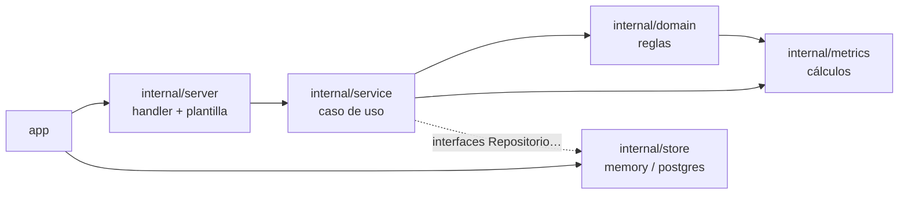
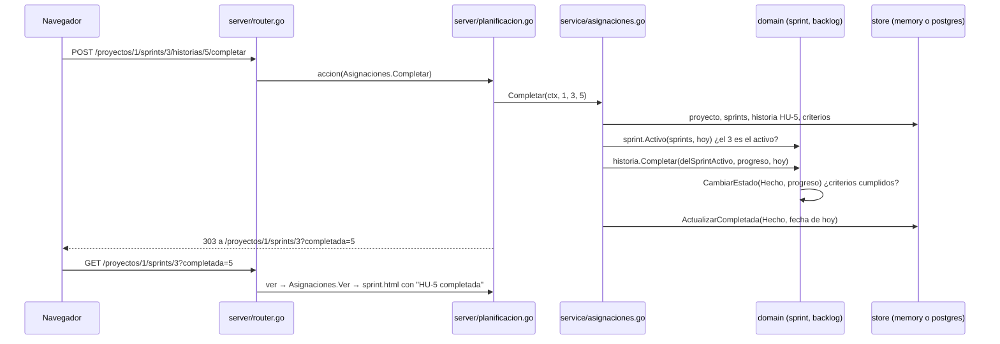
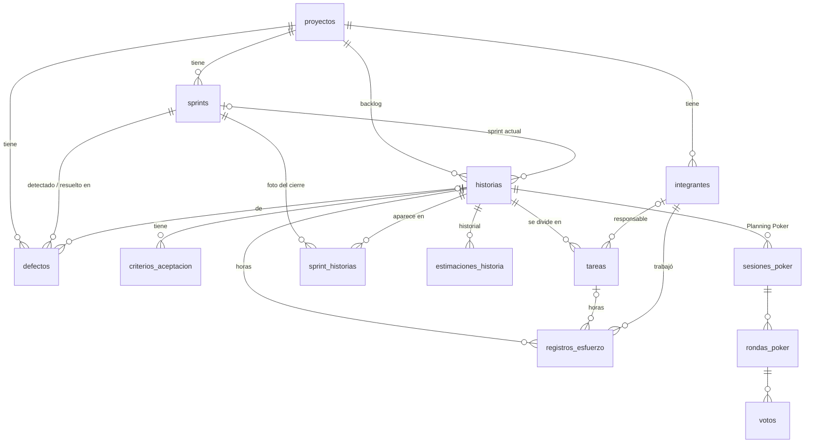
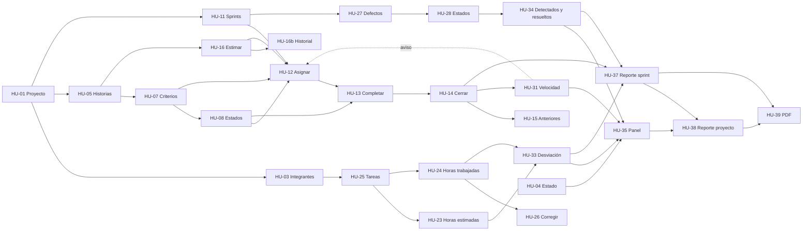

# Guía del proyecto

> **Para el equipo** (24/10/2026, Juan Pablo). Explica cómo funciona todo el proyecto, archivo por archivo, para poder
> defenderlo ante los profesores: qué hace cada parte, dónde está el código de cada historia y cómo se usan las partes
> entre sí. Describe `main` con HU-38, HU-39 y el proyecto de ejemplo (`cmd/ejemplo`) ya mergeados.
>
> No reemplaza a los otros documentos: la arquitectura formal está en [`arquitectura.md`](arquitectura.md), las fórmulas
> en [`metricas.md`](metricas.md), las tablas en [`modelo-datos.md`](modelo-datos.md) y el detalle de cada historia en su
> spec de [`specs/`](../specs/). Esta guía es el mapa para moverse entre todos ellos.

## Índice

1. [La aplicación en un minuto](#1-la-aplicación-en-un-minuto)
2. [Mapa del repositorio](#2-mapa-del-repositorio)
3. [Cómo leer el código](#3-cómo-leer-el-código)
4. [Un pedido de punta a punta](#4-un-pedido-de-punta-a-punta)
5. [El modelo de datos](#5-el-modelo-de-datos)
6. [Las funcionalidades, épica por épica](#6-las-funcionalidades-épica-por-épica)
7. [Cómo se conectan las funcionalidades](#7-cómo-se-conectan-las-funcionalidades)
8. [Las pruebas](#8-las-pruebas)
9. [La trazabilidad para la defensa](#9-la-trazabilidad-para-la-defensa)
10. [Comandos y entornos](#10-comandos-y-entornos)
11. [Lo que falta (Sprint 4)](#11-lo-que-falta-sprint-4)
12. [Glosario](#12-glosario)

---

## 1. La aplicación en un minuto

**Software Metrics & Estimation** sigue un proyecto ágil de punta a punta:

1. Se crea un **proyecto** con fechas y se registran sus **integrantes**.
2. Se arma el **Product Backlog**: historias con criterios de aceptación, prioridad y **story points** (SP).
3. Se crean **sprints** con su Sprint Goal y se les **asignan** historias listas.
4. Durante el sprint, las historias se **dividen en tareas**, se **registran horas** y **defectos**, y se **completan**
   cuando cumplen todos sus criterios.
5. Al **cerrar el sprint** se guarda una **foto** de lo que tenía y de lo que se terminó. Las historias que no se
   terminaron vuelven al backlog.
6. Con todo eso se calculan las **métricas** de la consigna (M1 a M9: SP, velocidad, horas, desviación, defectos), que
   se ven en el **panel** y en los **reportes**, también en **PDF**.

Es una aplicación web en Go que arma cada página en el servidor. Corre en Vercel con PostgreSQL de Supabase y login de
Supabase Auth, o en la computadora sin nada instalado: con los datos en memoria y sin login.

### Épicas y responsables

| Épica | Historias | Responsable | Estado al 24/10 |
|---|---|---|---|
| E1 · Proyectos e integrantes | HU-01 a HU-04 | Juan Pablo | Hechas |
| E2 · Product Backlog | HU-05 a HU-10 | Mariano | Hechas |
| E3 · Sprints | HU-11 a HU-15 | Juan Pablo | Hechas |
| E4 · Estimación | HU-16, HU-16b; Planning Poker HU-17 a HU-22 | Mariano | HU-16 y 16b hechas; Planning Poker en el Sprint 4 |
| E5 · Esfuerzo | HU-23 a HU-26 | Carolina | Hechas |
| E6 · Defectos | HU-27 a HU-29 | Carolina | Hechas |
| E7 · Métricas y panel | HU-30 a HU-35; gráficos HU-36 | Carolina | HU-30 a HU-35 hechas; HU-36 en el Sprint 4 |
| E8 · Reportes | HU-37 a HU-39 | Juan Pablo | HU-37 hecha; HU-38 y HU-39 en revisión |
| Técnicas | TEC-04 deploy, TEC-05 login, TEC-06 cobertura, TEC-07 diseño | Carolina (04, 07), Mariano (05, 06) | Hechas |

---

## 2. Mapa del repositorio

La consigna pide la cadena **Historia → Spec SDD → Criterios → Escenarios BDD → Tests → Código Go**. Cada eslabón tiene
su lugar:

| Eslabón | Dónde | Ejemplo con HU-14 |
|---|---|---|
| Historia | Issue en GitHub con sus criterios y sus tareas (sub-issues con horas) | #46 |
| Spec SDD | [`specs/`](../specs/), un archivo por historia | [`specs/HU-14-cerrar-sprint.md`](../specs/HU-14-cerrar-sprint.md) |
| Criterios | Sección 8 de la spec (`CA-14.1`…) | CA-14.1 a CA-14.4 |
| Escenarios BDD | [`features/`](../features/), un `.feature` por historia, con la etiqueta del criterio | [`hu-14-cerrar-sprint.feature`](../features/hu-14-cerrar-sprint.feature) |
| Pasos BDD | `features/huNN_steps_test.go` | [`hu14_steps_test.go`](../features/hu14_steps_test.go) |
| Tests | `*_test.go` al lado de cada archivo de código | [`sprint/cerrar_test.go`](../internal/domain/sprint/cerrar_test.go) |
| Código Go | `internal/…` | [`sprint/cerrar.go`](../internal/domain/sprint/cerrar.go), [`service/cierres.go`](../internal/service/cierres.go) |

El resto del repositorio:

```text
api/index.go              función de Vercel: le pasa cada pedido al router de app
app/app.go                arma la aplicación: memoria o PostgreSQL, casos de uso y router
cmd/server/               servidor local (go run ./cmd/server)
cmd/ejemplo/              la app con un proyecto de ejemplo cargado (go run ./cmd/ejemplo)
cmd/migrar/               aplica las migraciones (up, status)
cmd/cobertura/            umbral de cobertura del CI (TEC-06)
internal/domain/          entidades y reglas de negocio, un subpaquete por épica
internal/metrics/         las métricas M1 a M9, funciones puras
internal/service/         los casos de uso: un archivo por funcionalidad
internal/store/memory/    repositorios en memoria
internal/store/postgres/  repositorios en PostgreSQL (pgx)
internal/server/          rutas, handlers, middleware de sesión y renderizado
internal/auth/            Supabase Auth: configuración, verificación del token y cliente (TEC-05)
internal/reportepdf/      reportes en PDF (HU-39)
internal/ejemplo/         el proyecto de ejemplo, cargado con los casos de uso
internal/cobertura/       mide la cobertura del perfil de go test (TEC-06)
migrations/               migraciones SQL (goose), embebidas en el binario
web/templates/            base.html (layout), componentes.html y una página por pantalla en paginas/
features/                 escenarios BDD en español y sus pasos
specs/                    especificaciones SDD (y _plantilla.md)
docs/                     métricas, modelo de datos, deploy, Scrum, IA, trazabilidad y estos documentos
```

---

## 3. Cómo leer el código

### Las capas y hacia dónde apuntan



- **`domain`** decide **si algo vale** (validaciones y reglas). No sabe nada de bases ni de HTTP: recibe datos y
  devuelve un resultado o un error.
- **`metrics`** **calcula** las métricas a partir de structs simples.
- **`service`** **coordina**: busca con los repositorios, le pregunta al dominio, calcula con `metrics` y guarda.
  Define las interfaces de los repositorios que necesita (por ejemplo `RepositorioSprints`).
- **`store`** **guarda y lee**. `memory` y `postgres` implementan las mismas interfaces.
- **`server`** **traduce HTTP**: lee la URL y el formulario, llama al caso de uso y responde con una página o una
  redirección.
- **`app`** **arma todo**: elige el store, crea los casos de uso y se los pasa al router
  ([`app/app.go`](../app/app.go), `DependenciasConBase`).

### Convenciones que se repiten en todo el código

| Si ves… | Es… | Ejemplo |
|---|---|---|
| `Nuevo…` / `Nueva…` en el dominio | Validar datos y crear la entidad | `project.Nuevo`, `backlog.Nueva`, `sprint.Nuevo` |
| `Nuevo…` en `service` | El constructor del caso de uso, con sus repositorios | `service.NuevoCierres(...)` |
| Métodos que devuelven la entidad cambiada | El dominio no modifica lo que recibe: devuelve una copia | `h.CambiarEstado(...)`, `h.Completar(...)` |
| `Err…` | Un error de la regla, reconocible con `errors.Is` | `sprint.ErrNoEsElActivo` |
| `domain.ErroresValidacion` | Todos los errores de un formulario juntos, uno por campo | El 422 con el mensaje al lado de cada campo |
| `Campo…` | El nombre del campo del formulario | `project.CampoNombre = "nombre"` |
| `Vista…` | Lo que necesita una página, armado por el caso de uso | `service.VistaSprint`, `VistaPanel` |
| `…Texto()` | El valor como se muestra ("38,5 %", "+2 h") | `StoryPoints.CumplimientoTexto()` |
| `Ver`, `Listar`, `Consultar` | Casos de uso que solo leen | `Panel.Ver` |
| `RN3`, `CA-14.2` en un comentario | La regla de negocio o el criterio de la spec que implementa esa línea | `// CA-04.3: sin sprints…` |
| `ahora func() time.Time` | El reloj inyectado: `time.Now` en la app, una fecha fija en los tests | `NuevoCierres(..., time.Now)` |

Los comentarios de cada función dicen qué historia y qué regla implementan. Para encontrar el código de una regla se
puede buscar su código, por ejemplo `grep -rn "CA-14.2" internal/`.

---

## 4. Un pedido de punta a punta

**Completar una historia del sprint activo (HU-13).** El usuario aprieta **Completar** en la HU-5 del Sprint 3.



1. **El botón** está en [`web/templates/paginas/sprint.html`](../web/templates/paginas/sprint.html): es un
   `<form method="post">`, sin JavaScript.
2. **La ruta** está en [`internal/server/router.go`](../internal/server/router.go), dentro de `rutas()`. Con el login
   activo, antes pasa por el middleware `requiereSesion` ([`cuentas.go`](../internal/server/cuentas.go)), que valida
   la cookie `sesion`.
3. **El handler** `planificacion.accion` ([`planificacion.go`](../internal/server/planificacion.go)) lee el proyecto,
   el sprint y la historia de la URL y llama al caso de uso.
4. **El caso de uso** `Asignaciones.Completar` ([`service/asignaciones.go`](../internal/service/asignaciones.go)) busca
   los datos, calcula "hoy" en Argentina y le pregunta al dominio.
5. **El dominio** decide: `sprint.Activo` ([`sprint/activo.go`](../internal/domain/sprint/activo.go)) dice cuál es el
   sprint activo, y `Historia.Completar` ([`backlog/completar.go`](../internal/domain/backlog/completar.go)) usa la
   regla única de transiciones `CambiarEstado` ([`backlog/estados.go`](../internal/domain/backlog/estados.go)): para
   pasar a Hecho, los criterios tienen que estar todos cumplidos (HU-08).
6. **El repositorio** guarda el estado y la fecha juntos (`ActualizarCompletada`).
7. **La respuesta** es una redirección 303 a la página del sprint (patrón Post/Redirect/Get: recargar no repite la
   acción). Si la regla no lo deja, el handler muestra la misma página con el motivo y un 409.

Todas las pantallas que cambian algo siguen este mismo camino. Las de consulta (panel, reportes) hacen los pasos 2 a 5
sin guardar nada y responden con la página renderizada (`render` en [`server/render.go`](../internal/server/render.go)).

---

## 5. El modelo de datos



| Tabla | Qué guarda | Quién la escribe |
|---|---|---|
| `proyectos` | Nombre, fechas. El estado que se muestra se calcula (HU-04) | HU-01, HU-02 |
| `integrantes` | Nombre, email, rol, activo, `auth_user_id` (la cuenta vinculada) | HU-03; el vínculo, TEC-05 |
| `sprints` | Número, objetivo, fechas, estado y, al cerrar, `sp_planificados` y `sp_completados` | HU-11; HU-14 al cerrar |
| `historias` | Número (HU-N), título, prioridad, estado, SP, `sprint_id`, fecha de completado, orden | HU-05 a HU-10, HU-12 a HU-14, HU-16 |
| `criterios_aceptacion` | Descripción y si está cumplido | HU-07 |
| `tareas` | Título, responsable, horas estimadas, completada | HU-25 (y HU-23) |
| `registros_esfuerzo` | Quién, qué día, cuántas horas, en qué historia o tarea | HU-24, HU-26 |
| `defectos` | Descripción, severidad, estado, sprint de detección y de resolución | HU-27, HU-28 |
| `sprint_historias` | **La foto del cierre**: qué historias tenía el sprint, con qué SP, y si se completaron | HU-14 |
| `estimaciones_historia` | Cada re-estimación: valor anterior, nuevo y cuándo | HU-16b |
| `sesiones_poker`, `rondas_poker`, `votos` | Planning Poker: ya están creadas, sin código todavía | HU-17 a HU-22 (Sprint 4) |

Las migraciones están en [`migrations/`](../migrations/): `0001` el modelo inicial (con RLS en todas las tablas),
`0002` el RLS de la tabla de versiones de goose y `0003` el historial de estimaciones. El detalle de columnas y
restricciones (por ejemplo, el `CHECK` de la escala de SP) está en [`modelo-datos.md`](modelo-datos.md).

---

## 6. Las funcionalidades, épica por épica

Para cada historia: qué hace, la regla que más preguntan, y dónde está cada capa. Las rutas de los archivos son desde
la raíz del repositorio. Las de dominio están bajo `internal/domain/`, las de casos de uso bajo `internal/service/` y
las de pantalla bajo `internal/server/` y `web/templates/paginas/`.

### E1 · Proyectos e integrantes (Juan Pablo)

| HU | Qué hace | Regla clave | Dominio | Caso de uso | Pantalla |
|---|---|---|---|---|---|
| 01 | Crear un proyecto | Nombre único sin importar mayúsculas; fin posterior al inicio; todos los errores juntos | `project/project.go` (`Nuevo`) | `proyectos.go` (`Crear`) | `proyectos.go` · `proyecto_nuevo.html` |
| 02 | Modificar un proyecto | Las fechas no pueden dejar sprints afuera; uno Finalizado no se modifica | `project/modificar.go` (`Modificar`), `sprint/limites.go` | `edicion.go` | `edicion.go` · `proyecto_editar.html` |
| 03 | Registrar integrantes y darlos de baja | Email único en el proyecto; un solo Agile Enabler activo; no se borran | `member/member.go` | `integrantes.go` | `integrantes.go` · `integrantes.html`, `integrante_nuevo.html` |
| 04 | Ver el estado del proyecto | El estado **se calcula**: Planificado, En curso (desde el primer sprint) o Finalizado; "hoy" en Argentina | `project/estado.go` (`EstadoActual`), `sprint/activo.go` (`Activo`, `Proximo`) | `estado.go` (`EstadoProyectos`) | `proyectos.go` (`ver`) · `proyecto.html` |

### E2 · Product Backlog (Mariano)

| HU | Qué hace | Regla clave | Dominio | Caso de uso | Pantalla |
|---|---|---|---|---|---|
| 05 | Crear una historia | Número correlativo HU-N; SP de la escala Fibonacci o sin estimar | `backlog/backlog.go` (`Nueva`) | `historias.go` (`Crear`) | `historias.go` · `historia_nueva.html` |
| 06 | Editar y eliminar | No se elimina una Hecha ni una de un sprint cerrado; se borra con sus criterios y tareas | `backlog/edicion.go`, `eliminar.go` | `edicion_historias.go` | `edicion_historias.go` · `historia_editar.html`, `historia_eliminar.html` |
| 07 | Criterios de aceptación | `Progreso` "2/3"; sin criterios no está completa; en una Hecha no se tocan | `backlog/criterios.go` | `criterios.go` | `criterios.go` · `historia.html` |
| 08 | Cambiar el estado | **Una sola tabla de transiciones** (`CambiarEstado`); a Hecho solo con todos los criterios cumplidos | `backlog/estados.go` | `estados.go` | `estados.go` · `historia.html` |
| 09 | Priorizar | Subir y Bajar dentro de cada prioridad; las Hechas aparte | `backlog/priorizar.go` (`Ordenar`, `Mover`) | `historias.go` (`Backlog`, `Mover`) | `historias.go` · `backlog.html` |
| 10 | Filtrar y buscar | Por estado, prioridad y texto, sin distinguir mayúsculas ni tildes | `backlog/filtrar.go` | `historias.go` (`Buscar`) | `historias.go` · `backlog.html` |

### E3 · Sprints (Juan Pablo)

| HU | Qué hace | Regla clave | Dominio | Caso de uso | Pantalla |
|---|---|---|---|---|---|
| 11 | Crear un sprint | Dentro del proyecto; empieza después del último; número automático | `sprint/sprint.go` (`Nuevo`) | `sprints.go` (`Crear`) | `sprints.go` · `sprint_nuevo.html`, `sprints.html` |
| 12 | Asignar y quitar historias | Solo historias estimadas, con criterios y Pendientes; aviso (no bloqueo) si se supera la velocidad | `backlog/asignar.go` (`AsignarA`, `QuitarDelSprint`) | `asignaciones.go` (`Ver`, `Asignar`, `Quitar`) | `planificacion.go` · `sprint.html` |
| 13 | Empezar y completar historias | Solo en el **sprint activo**; con todos los criterios cumplidos; guarda la fecha | `backlog/completar.go`, `sprint/activo.go` | `asignaciones.go` (`Empezar`, `Completar`) | `planificacion.go` · `sprint.html` |
| 14 | Cerrar el sprint | Solo el activo; guarda **la foto** y los SP; las no terminadas vuelven al backlog; todo en una transacción | `sprint/cerrar.go` (`Cerrar`) | `cierres.go` (`Preparar`, `Cerrar`) | `cierres.go` · `sprint_cerrar.html` |
| 15 | Ver sprints anteriores | SP completados y cumplimiento de cada cerrado, tomados **de la foto** | `metrics/cumplimiento.go` | `anteriores.go` (`Sprints.Resumir`, `Cierres.Detalle`) | `sprints.go` · `sprints.html`, `sprint.html` |

### E4 · Estimación (Mariano)

| HU | Qué hace | Regla clave | Dominio | Caso de uso | Pantalla |
|---|---|---|---|---|---|
| 16 | Estimar con SP | Escala 0, 1, 2, 3, 5, 8, 13, 21; una Hecha no se re-estima | `backlog/estimar.go` (`Estimar`) | `estimaciones.go` | `estimaciones.go` · `historia.html` |
| 16b | Historial de estimaciones | Se anota solo cuando cambia un valor que ya existía; nunca se edita | `backlog/reestimacion.go` (`NuevaReestimacion`) | `criterios.go` (`ConHistorial`, en la vista de la historia) | `historia.html` |

### E5 · Esfuerzo (Carolina)

| HU | Qué hace | Regla clave | Dominio | Caso de uso | Pantalla |
|---|---|---|---|---|---|
| 23 | Horas estimadas | Las de una historia son la **suma de sus tareas** | `effort/horas.go` (`HorasEstimadasDeHistoria`, `ParsearHoras`) | `tareas.go`, `horas.go` | `tareas.html` |
| 24 | Registrar horas trabajadas | Fecha dentro del proyecto y no futura; máximo 24 h por integrante y día | `effort/registros.go` (`NuevoRegistro`) | `esfuerzo.go` | `esfuerzo.go` · `esfuerzo.html` |
| 25 | Dividir en tareas | Responsable activo; una tarea completada no cambia su estimación | `effort/tareas.go` (`NuevaTarea`) | `tareas.go` | `tareas.go` · `tareas.html` |
| 26 | Consultar y corregir registros | Cada uno corrige los suyos; el Agile Enabler, todos | `effort/correccion.go` (`Corregir`, `PuedeCorregir`) | `registros_esfuerzo.go` | `registros_esfuerzo.go` · `registros_esfuerzo.html`, `corregir_registro.html` |

### E6 · Defectos (Carolina)

| HU | Qué hace | Regla clave | Dominio | Caso de uso | Pantalla |
|---|---|---|---|---|---|
| 27 | Registrar un defecto | Severidad Crítica, Alta, Media o Baja; sprint de detección del proyecto; nace Abierto | `defect/defect.go` (`Nuevo`) | `defectos.go` (`Registrar`) | `defectos.go` · `defectos.html` |
| 28 | Cambiar su estado | Abierto → En progreso → Resuelto → Cerrado o Reabierto; al resolver se elige el sprint (no anterior al de detección) | `defect/estados.go` | `defectos.go` (`CambiarEstado`) | `defectos.html` |
| 29 | Consultar con filtros | Severidad, estado y sprint; un valor que no existe se ignora | `defect/filtro.go` | `defectos.go` (`Consultar`) | `defectos.html` |

### E7 · Métricas y panel (Carolina)

Las métricas son funciones puras de [`internal/metrics`](../internal/metrics/). Cada una tiene su historia y se
reutiliza en varias pantallas (sección 7).

| HU | Métrica | Función | Regla clave |
|---|---|---|---|
| 30 | M1 SP planificados, M2 SP completados | `storypoints.go` (`CalcularStoryPoints`, `SumarStoryPoints`) | Una historia sin estimar suma 0 y se avisa |
| 31 | M3 Velocidad | `velocity.go` (`CalcularVelocidad`) | Promedio de los **últimos 3 sprints cerrados** (o los que haya) |
| 32 | M7 % de historias completadas | `completion.go` (`CalcularPorcentajeCompletadas`) | Sin historias da 0 %, nunca divide por cero |
| 33 | M4 horas estimadas, M5 reales, M6 desviación | `deviation.go` (`CalcularDesviacion`, `SumarDesviaciones`) | El % del sprint suma horas y después divide; sin estimadas "no aplicable" |
| 34 | M8 defectos detectados, M9 resueltos | `defects.go` (`ContarDefectos`) | Detectado por su sprint de detección, resuelto por el de resolución |
| 35 | Panel del proyecto | `service/panel.go` (`Panel.Ver`, `Tarjetas`) | Seis tarjetas; la que no tiene datos dice "sin datos" |

Pantallas: horas en `horas.go` · `horas.html` (HU-33), resumen de defectos en `defectos.html` (HU-34) y el panel en
`panel.go` · `panel.html` (HU-35).

### E8 · Reportes (Juan Pablo)

| HU | Qué hace | Regla clave | Código |
|---|---|---|---|
| 37 | Reporte de un sprint | Si está cerrado usa la foto; si no, los datos de hoy con el aviso de parcial; velocidad hasta ese sprint | `service/reportes.go` (`Reportes.Sprint`) · `server/reportes.go` · `reporte_sprint.html` |
| 38 | Reporte del proyecto | El resumen es el mismo del panel; un bloque por sprint igual a su reporte; evolución de la velocidad | `service/reportes_proyecto.go` (`Reportes.Proyecto`) · `reporte_proyecto.html` |
| 39 | Exportar a PDF | El mismo contenido y los mismos textos que la página; nombre `proyecto-sprint-N-fecha.pdf` | `internal/reportepdf/` (`documento.go`, `pdf.go`, `nombre.go`) · rutas `….pdf` en `server/reportes.go` |

### Técnicas

| Tarea | Qué hace | Código |
|---|---|---|
| TEC-04 | Deploy en Vercel y `/health`, que dice si la base responde | [`server/health.go`](../internal/server/health.go), [`api/index.go`](../api/index.go), [`vercel.json`](../vercel.json) |
| TEC-05 | Login con Supabase Auth, vínculo cuenta ↔ integrante por email | [`internal/auth/`](../internal/auth/), `domain/account`, `service/cuentas.go`, `server/cuentas.go` · `login.html`, `registro.html` |
| TEC-06 | Umbral de cobertura del 80 % y matriz de trazabilidad con su test | [`internal/cobertura/`](../internal/cobertura/), [`cmd/cobertura/`](../cmd/cobertura/), [`features/trazabilidad_test.go`](../features/trazabilidad_test.go) |
| TEC-07 | Diseño base: layout, navegación y componentes reutilizables (`exito`, `error`, `aviso`, `confirmar`, `metrica`) | [`web/templates/base.html`](../web/templates/base.html), [`componentes.html`](../web/templates/componentes.html) |

---

## 7. Cómo se conectan las funcionalidades

Ninguna historia está aislada: las de métricas y reportes **reutilizan** el código de las anteriores en lugar de
recalcular. Es una de las cosas que más vale la pena mostrar, porque explica por qué el panel y los reportes nunca dan
distinto.

### 7.1 Qué historia necesita de cuál



### 7.2 Casos de uso que usan otros casos de uso

Se ve en [`app/app.go`](../app/app.go): algunos casos de uso se construyen pasándoles otros.

| Caso de uso | Usa | Para qué |
|---|---|---|
| `Panel` (HU-35) | `EstadoProyectos` (HU-04), `Horas` (HU-33), `Defectos` (HU-34) y la velocidad (HU-31) | Las seis tarjetas salen de lo que ya calculan las otras historias |
| `Reportes` (HU-37, HU-38) | `Cierres` (HU-14, la foto), `Horas` (HU-33), `Panel` (HU-35) y los defectos | El reporte del sprint junta métricas; el del proyecto toma el resumen del panel tal cual |
| `reportepdf` (HU-39) | `ReporteSprint` y `ReporteProyecto` (HU-37, HU-38) | El PDF recibe el mismo struct que la página y usa sus métodos `…Texto()` |
| `RegistrosEsfuerzo` (HU-26) | `Horas` (HU-33) | Muestra estimadas vs reales de las historias de la lista |
| `Asignaciones` (HU-12, HU-13) | `Criterios` (HU-07) | El progreso de los criterios: si se puede asignar y si se puede completar |
| `Criterios` (vista de la historia) | El historial de estimaciones (HU-16b), con `ConHistorial` | La página de la historia muestra su historial |
| `Cuentas` (TEC-05) | El repositorio de integrantes | Vincula la cuenta con el integrante que tiene su email |

### 7.3 Reglas del dominio que usan varias historias

| Regla | Dónde | La usan |
|---|---|---|
| `Historia.CambiarEstado` (la tabla de transiciones) | `backlog/estados.go` | HU-08 (pantalla), HU-12 (a En sprint), HU-13 (a Hecho), HU-14 (de vuelta a Pendiente) |
| `Progreso` de los criterios | `backlog/criterios.go` | HU-07, HU-08, HU-12 (sin criterios no se asigna), HU-13 (sin todos cumplidos no se completa) |
| `Historia.Estimar` | `backlog/estimar.go` | HU-16 y, en el Sprint 4, el valor acordado del Planning Poker |
| `sprint.Activo` | `sprint/activo.go` | HU-04 (sprint activo), HU-13 (solo se completa en el activo), HU-14 (solo se cierra el activo) |
| `domain.HoyEnArgentina` | `domain/fecha.go` | Toda regla con "hoy": estado, activo, completar, cerrar, horas no futuras, nombre del PDF |
| `member.ValidarFormatoEmail` | `member/member.go` | HU-03 y el registro de cuentas (TEC-05) |

### 7.4 Cada métrica, dónde se calcula y dónde se ve

| Métrica | Función | Se usa en |
|---|---|---|
| M1, M2 (HU-30) | `metrics.CalcularStoryPoints` | **El cierre** (`sprint.Cerrar` guarda los SP en la foto), el estado del proyecto (HU-04), el reporte de un sprint abierto (HU-37) |
| Cumplimiento (HU-15) | `StoryPoints.Cumplimiento` | La lista de sprints, el detalle de un cerrado, los reportes |
| M3 (HU-31) | `metrics.CalcularVelocidad`, vía `velocidadDe` en `service/panel.go` | El panel, el aviso al asignar (HU-12), cada reporte de sprint (con los sprints hasta ese) y la evolución (HU-38) |
| M4, M5, M6 (HU-33) | `metrics.CalcularDesviacion` y `SumarDesviaciones`, vía `Horas.desviacionDe` | La página de horas, el panel, los reportes, la consulta de registros (HU-26) |
| M7 (HU-32) | `metrics.CalcularPorcentajeCompletadas` | Los reportes y el resumen de un sprint cerrado |
| M8, M9 (HU-34) | `metrics.ContarDefectos` | La página de defectos, el panel y los reportes |

### 7.5 La foto del cierre: por qué existe y quién la lee

Cuando se cierra un sprint (HU-14), `sprint.Cerrar` arma un `Cierre` con el sprint marcado Cerrado, sus SP
planificados y completados, y una **foto** (`sprint_historias`): cada historia que estaba, con sus SP de ese momento y
si se completó. Después, aunque una historia se re-estime o vuelva a otro sprint, el resultado del sprint cerrado no
cambia. La leen:

- **HU-15**: la lista de sprints y el detalle de un cerrado (`Sprints.Resumir`, `Cierres.Detalle`).
- **HU-31**: la velocidad usa `Sprint.SPCompletados`, que guardó el cierre.
- **HU-37 y HU-38**: el reporte de un sprint cerrado muestra la foto, no los datos de hoy.
- **HU-06**: una historia que está en alguna foto no se puede eliminar (`EnSprintCerrado`).

### 7.6 El login atraviesa todo (TEC-05)

El login no toca ninguna historia: es un middleware. [`app/app.go`](../app/app.go) lo activa si están `SUPABASE_URL` y
`SUPABASE_ANON_KEY`. [`server/router.go`](../internal/server/router.go) mete todas las rutas de las historias en un
grupo con `requiereSesion`. Sin esas variables (local, tests, previews) el mismo router funciona abierto.

---

## 8. Las pruebas

| Nivel | Qué prueba | Cómo | Dónde |
|---|---|---|---|
| Unitarias del dominio y las métricas | Cada regla, con tablas de casos (bordes incluidos) | Datos de entrada → resultado o error, sin dobles | `internal/domain/**/…_test.go`, `internal/metrics/…_test.go` |
| Casos de uso | Que coordinen bien y que un rechazo no guarde nada | Repositorios en memoria o dobles que fallan; reloj fijo | `internal/service/…_test.go` |
| Repositorios | Que memoria y PostgreSQL se comporten igual | Contra un PostgreSQL descartable (`TEST_DATABASE_URL`): cada test crea y borra su esquema | `internal/store/**/…_test.go` |
| Pantallas | Código HTTP, textos, formularios, redirecciones | `httptest` contra el router | `internal/server/…_test.go` |
| Aplicación | Todo armado, en memoria y en PostgreSQL | `app.NewHandlerConBase` y pedidos HTTP | `app/…_test.go` |
| BDD | Los escenarios de cada `.feature` | godog en español; los pasos arman los casos de uso con repositorios en memoria y a veces el router | `features/` |
| Trazabilidad | Que la matriz no mienta | Lee `docs/trazabilidad-requisitos.md` y busca que existan los escenarios y tests que nombra | `features/trazabilidad_test.go` |

**Cómo encontrar los tests de algo:**
- Por criterio: la tabla *Criterio → Escenarios → Tests* de la sección Trazabilidad de su spec.
- Por nombre: los tests se llaman `Test<Qué>_<Caso>`, por ejemplo `TestCerrar_LasNoCompletadasVuelvenAlBacklog`.
- Por etiqueta: cada escenario lleva `@CA-14.2` arriba, así `grep -rn "@CA-14.2" features/` da sus escenarios.

**La evidencia de TDD** está en el historial de cada PR: un commit `test(HU-xx): RED - …` con los tests (que fallan)
antes del `feat(HU-xx): GREEN - …` con el código. Se ve con `git log --oneline` o en la pestaña Commits del PR.

---

## 9. La trazabilidad para la defensa

Los profesores eligen una funcionalidad y hay que recorrer la cadena completa. La receta sirve para cualquier historia:

| Paso | Qué abrir | Qué decir |
|---|---|---|
| 1. Historia | El issue en el tablero (por ejemplo #46) | El "como… quiero… para…", los criterios y las tareas con horas |
| 2. Spec | `specs/HU-NN-….md` | Reglas de negocio (RN), casos límite, errores y los criterios CA-NN.x |
| 3. Escenarios | `features/hu-NN-….feature` | Un escenario por caso normal, alternativo y de error, con la etiqueta del criterio |
| 4. Pasos | `features/huNN_steps_test.go` | Cómo cada frase del escenario llama al caso de uso |
| 5. Tests | La tabla de trazabilidad de la spec | El test que cubre ese criterio, y el commit RED anterior al GREEN |
| 6. Código | Dominio → caso de uso → handler → plantilla | La regla en el dominio, la coordinación en `service`, la pantalla en `server` |
| 7. Matriz | `docs/trazabilidad-requisitos.md` | La fila del requerimiento de la consigna que cubre la historia |

**Ejemplo completo con HU-14 (cerrar sprint):**

1. Issue **#46**: "Como Agile Enabler quiero cerrar el sprint para consolidar sus resultados".
2. Spec [`HU-14-cerrar-sprint.md`](../specs/HU-14-cerrar-sprint.md): RN1 solo el activo, RN3 la foto, RN6 todo o nada;
   CA-14.1 a CA-14.4.
3. Escenario "Las historias no completadas vuelven al backlog" (`@CA-14.2`) en
   [`hu-14-cerrar-sprint.feature`](../features/hu-14-cerrar-sprint.feature).
4. Sus pasos en [`hu14_steps_test.go`](../features/hu14_steps_test.go) arman `service.NuevoCierres` con repositorios en
   memoria y un reloj fijo.
5. Tests de CA-14.2: `TestCerrar_LasNoCompletadasVuelvenAlBacklog` (dominio), `TestCierres_Cerrar` (repositorios en
   memoria y en PostgreSQL), `TestCerrarSprint_LaNoCompletadaVuelveAlBacklog` (pantalla).
6. Código: `sprint.Cerrar` en [`cerrar.go`](../internal/domain/sprint/cerrar.go) recorre las historias del sprint y
   devuelve las no Hechas a Pendiente con `CambiarEstado` (la regla de HU-08). `Cierres.Cerrar` en
   [`service/cierres.go`](../internal/service/cierres.go) guarda todo junto. En PostgreSQL es una transacción
   ([`store/postgres/cierres.go`](../internal/store/postgres/cierres.go)). La pantalla está en
   [`server/cierres.go`](../internal/server/cierres.go) y `sprint_cerrar.html`.
7. Matriz: la fila «Sprints · Cerrar un Sprint», cubierta por HU-14.

**Cada uno ensaya una historia propia** (ver el [guion](presentacion/guion-demo.md)): Juan Pablo HU-39, Mariano HU-18
(o la que tenga terminada) y Carolina HU-35.

---

## 10. Comandos y entornos

```bash
go run ./cmd/server
```

La app en http://localhost:8080. Sin `DATABASE_URL` guarda en memoria y sin las variables de Supabase no pide login.

```bash
go run ./cmd/ejemplo
```

La app en memoria con el proyecto de ejemplo: 3 integrantes, 2 sprints cerrados, el 3 activo, 10 historias, horas y
5 defectos. Las fechas se arman alrededor de hoy. Con `-base` lo carga en la base de `DATABASE_URL` (lo corre Juan
Pablo para producción) y con `-emails a,b,c` vincula a cada integrante con su cuenta.

```bash
go test ./...
```

Todos los tests y los escenarios BDD. Los de PostgreSQL necesitan `TEST_DATABASE_URL`; sin ella se omiten.

```bash
go test -covermode=atomic -coverprofile=coverage.out ./... && go run ./cmd/cobertura
```

El umbral de cobertura del CI (TEC-06).

| Entorno | Base | Login | Cuándo |
|---|---|---|---|
| Local | Memoria (o un PostgreSQL propio con `DATABASE_URL`) | No | Desarrollo y demo sin internet |
| Preview de Vercel | Memoria | No | Cada PR, para revisar la pantalla |
| Producción | PostgreSQL de Supabase | Sí, registro cerrado | https://seguimiento-medicion.vercel.app |
| CI (GitHub Actions) | PostgreSQL propio del job | No | Cada PR: gofmt, vet, lint, tests, BDD, umbral |

Las migraciones de producción las aplica Juan Pablo con `go run ./cmd/migrar up` y la URL del *session pooler*
([`deploy.md`](deploy.md)).

---

## 11. Lo que falta (Sprint 4)

| Qué | Dónde va a entrar | De qué depende |
|---|---|---|
| Planning Poker (HU-17 a HU-22, Mariano y Carolina) | Las tablas `sesiones_poker`, `rondas_poker` y `votos` ya existen desde `0001`; el valor acordado se guarda con `Historia.Estimar` (HU-16) | Saber quién vota: `Cuentas.Quien` (TEC-05) |
| Gráficos del panel (HU-36, Carolina) | La página del panel, con los datos que ya arma `Panel.Ver` y la velocidad por sprint | HU-30, HU-31 y HU-33 |
| TEC-07b · retoque visual | Las plantillas de `web/templates/`; HTMX ya está cargado en el layout | — |
| Documentación de la entrega | `arquitectura.md`, `manual-usuario.md`, este documento y el guion | Todo lo anterior |

El código se congela el jueves 29/10 y la presentación es el lunes 02/11.

---

## 12. Glosario

| Término | Qué es |
|---|---|
| **SP** (story points) | Tamaño relativo de una historia, en la escala 0, 1, 2, 3, 5, 8, 13, 21 |
| **Sprint activo** | El sprint sin cerrar de menor número cuya fecha de inicio ya llegó. No se guarda: se calcula |
| **Foto del cierre** | Lo que guarda el cierre de un sprint en `sprint_historias`: sus historias con sus SP y si se completaron |
| **Velocidad** | Promedio de SP completados de los últimos 3 sprints cerrados |
| **Cumplimiento** | SP completados sobre SP planificados de un sprint cerrado |
| **Desviación** | Horas reales menos estimadas; en % sobre las estimadas |
| **RN / CA** | Regla de negocio / criterio de aceptación de una spec (`RN3`, `CA-14.2`) |
| **Caso de uso** | Un struct de `internal/service` con los métodos de una funcionalidad (`Cierres.Cerrar`) |
| **Repositorio** | Lo que guarda y lee; una interfaz en `service` con dos implementaciones (memoria y PostgreSQL) |
| **Vista** | El struct con todo lo que necesita una página (`VistaSprint`) |
| **PRG** | Post/Redirect/Get: después de un POST se redirige (303) a la página, así recargar no repite la acción |
| **Modo memoria** | Sin `DATABASE_URL`: los repositorios guardan en memoria y todo se pierde al reiniciar |
| **RED / GREEN** | El commit con los tests que fallan y el commit con el código que los hace pasar (TDD) |
